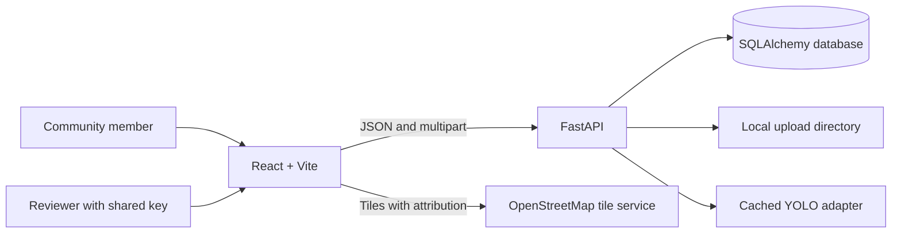

# Architecture

## Request and data flow

The API starts with SQLite for local development and accepts PostgreSQL connection URLs when the matching psycopg driver is installed. Tables are currently created with SQLAlchemy `create_all`; schema migrations are not yet implemented. The detector is lazily loaded and cached in process. When `MODEL_PATH` is empty and demo mode is enabled, scan returns zero detections with a clear demo message.

The browser builds annotation overlays from the returned box coordinates. Reports persist the submitted image after Pillow decodes and re-encodes it as JPEG, removing metadata. The current `/uploads` static mount and report-image endpoint are public; do not use them for private or sensitive evidence.

Status history is recorded for each report. A configured shared reviewer key gates status mutation only; there is no user identity or role system. Analytics are derived from the stored records returned by the API. Duplicate matching is a transparent spatial/category/time heuristic; it does not compute image similarity or automatically merge reports.
