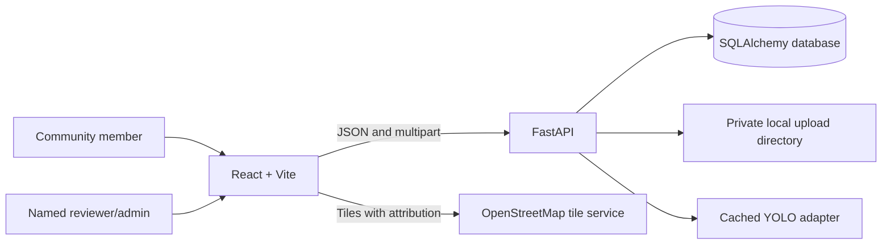

# Architecture

## Request and data flow

The API starts with SQLite for local development and accepts PostgreSQL connection URLs when the matching psycopg driver is installed. Alembic migrations version schema updates; `AUTO_MIGRATE=true` upgrades on local/development startup, while production should run `alembic upgrade head` as a release step with app auto-migration disabled. The detector is lazily loaded and cached in process. When `MODEL_PATH` is empty and demo mode is enabled, scan returns zero detections with a clear demo message.

The browser builds annotation overlays from returned box coordinates. Reports persist the submitted image after Pillow decodes and re-encodes it as JPEG, removing metadata. Images are not exposed through a static mount; the evidence API requires authority authentication. The local filesystem is not durable on hosts with ephemeral disks.

Status history records the username from an expiring HMAC-signed authority session. Verified reports can be assigned to a named team. An authorized repair-evidence upload stores a private after-image and completion note and moves an in-progress report to resolved. Citizens receive a random tracking key; only its hash is stored and the public tracking API returns a minimal status history. Authority accounts/roles are configured out-of-band using PBKDF2 password hashes. Duplicate matching is a transparent spatial/category/time heuristic; it does not compute image similarity or automatically merge reports.
